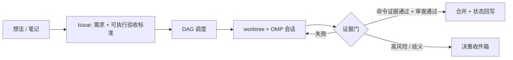

# temli — AI 原生项目工作空间

状态：v0.1 草案 · 2026-11-08

## 1. 定位

temli 是一个本地优先的桌面软件：从一个想法开始，AI 负责整理需求、拆解任务、调度 Agent 执行、验证结果并回写状态，人只在关键节点做决策。

v1 只服务作者本人：单机、单用户，复用本机已安装的 OMP 及其登录与额度，不做分发与签名。

四个空间（知识 / 文档 / 项目 / Agent）是**同一批项目数据的不同视图**，不是四个各自存储的模块。

## 2. 核心闭环

## 3. 信息架构

- 侧栏：概览、知识、文档、项目、Agent
- 默认落地：**概览** = 项目现状 + 决策收件箱 + 执行队列
- 文档正文在仓库 `docs/`；笔记在项目内 `.temli/notes/`（gitignored）；元数据、状态与检索索引在 SQLite
- Agent 空间展示会话、证据、审查报告、审批请求；任务本体属于项目空间

## 4. 里程碑

### M0 应用骨架
Tauri 2 + React + TS 外壳；SQLite（含 FTS5）与迁移；项目注册（本地路径 + GitHub 仓库）；IPC 层；无业务逻辑。

### M1 证据门（v1 核心）
Issue/任务模型与验收标准；单任务经 `omp --mode rpc` 执行；四类证据采集（测试、构建/lint、审查、产物）；状态机与决策收件箱；高风险变更识别。

### M2 队列与 worktree
任务队列串行消费；每任务独立 worktree 与分支；提交、证据归档、合并队列（串行、合并后重跑证据）；失败重试。

### M3 DAG 调度
任务依赖与阻塞关系；无依赖任务并发（上限可配，默认 1）；调度与合并冲突处理（自动 rebase、失败升级人工）。

### M4 GitHub 同步与自动合并
按 60s 轮询（条件请求）镜像 Issue；本地编辑带版本号提交；冲突时 GitHub 权威；PR 创建与 checks 展示；自动合并默认关闭，证据门全绿方可开启。

### v1 明确不做
跨项目知识库、向量检索、多 Agent 后端、夜间守护进程、团队协作、移动端、遥测。

## 5. 关键机制

### 5.1 验收标准
每个任务入队前必须有多条可执行验收标准（命令 + 预期结果）。v1 由规划 Agent 自动生成，生成器必须解析仓库真实存在的命令（package.json / Makefile / CI 配置）；命令不存在或无法判定断言时，该任务升级为人工确认，而不是静默入队。

### 5.2 证据门
任务完成由证据触发，不采信 Agent 自报：

1. 每条验收标准的实际执行输出、退出码、耗时
2. 变更文件清单与 diff
3. 独立审查 Agent 的结论（含测试/CI 改动摘要与风险标记）
4. 高风险变更清单（删除文件、依赖、迁移、CI 配置、权限相关）

放行：全部命令退出码为 0 + 审查通过 + 无未决高风险项。任一不满足则回到执行或进入决策收件箱，任务不得标记完成。

### 5.3 测试完整性
Agent 可以修改测试与 CI，但审查报告必须逐项列出测试/CI diff 摘要；无法取得修改前的断言对比时，该任务强制人工审批。

### 5.4 同步与冲突
- GitHub 是 Issue 标题、正文、状态、指派人的权威
- 本地扩展字段（证据、会话、依赖、工作树）不回写
- 本地编辑携带版本号提交；远端先行修改则远端胜出并在 UI 提示
- 无 webhook，仅轮询

### 5.5 后台执行
窗口关闭后队列继续执行（菜单栏常驻）；任务完成或需要决策时发系统通知。不引入独立守护进程。

### 5.6 预算与重试
单任务默认 30 分钟上限、3 次重试；超限进入决策收件箱，不无限重试。

## 6. 决策记录

| # | 决策 | 选择 |
|---|---|---|
| 1 | 服务对象 | 只给自己用 |
| 2 | 交付边界 | Issue 双向同步 + PR 自动合并 |
| 3 | 文档真源 | 交付文档进仓库 `docs/`，笔记私有 |
| 4 | 完成门 | 命令证据 + 审查 Agent + 高风险人工 |
| 5 | 调度 | 全量 DAG |
| 6 | 主界面 | 四空间侧栏，默认概览 |
| 7 | 验收标准 | 规划 Agent 自动生成 |
| 8 | 同步冲突 | GitHub 权威 + 本地扩展字段 |
| 9 | 后台 | 菜单栏常驻继续 |
| 10 | 测试完整性 | 允许修改，审查必须高亮 |
| 11 | 首个目标 | 新建带测试的小 demo 仓库 |

技术默认：macOS arm64、Tauri 2、React、TypeScript、SQLite/FTS5、TipTap；Agent 通过 `omp --mode rpc`（stdio JSONL）接入，适配器只暴露启动/事件流/审批回传三个方法。

## 7. 非功能要求

- 本地优先：断网时除同步与模型调用外全部可用；数据不出本机（模型调用除外）
- 单写者：同一 SQLite 库同一时间只有一个 App 实例写入
- 崩溃恢复：运行中的任务在重启后标记为 `interrupted`，不自动续跑，进入决策
- 可审计：每次合并都能追溯到 run、证据与审查报告

## 8. 风险

1. **自动合并 + 允许改测试**：放行权交给可修改判据的 Agent。缓解：审查报告强制列测试/CI diff；断言对比缺失即转人工；自动合并默认关闭。
2. **功能最大集叠加**：证据门会被同步与调度拖住。缓解：严格按 M1→M4 依赖顺序，架构按终态建、开关默认保守。
3. **OMP 协议耦合**：RPC 版本或事件结构变更会打断执行层。缓解：适配器隔离协议细节，事件归一化为内部事件。

## 9. 成功标准

- 用 temli 连续开发 temli 自身两周
- 任务完成的人工干预比例 < 30%
- 无未经审查的高风险合并
- 无绕过证据门标记完成的任务
