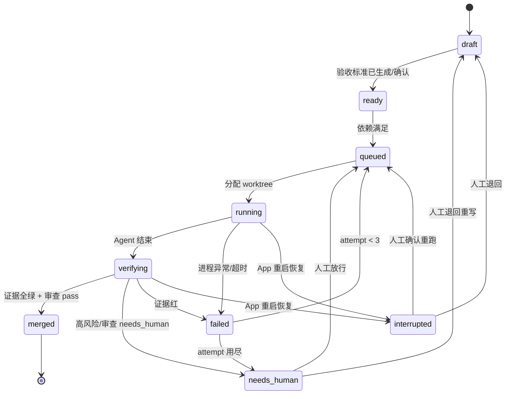

# 数据模型与状态机

配套文档：[PRD](./PRD.md)

## 1. 存储划分

| 内容 | 位置 | 权威 |
|---|---|---|
| 交付文档正文 | 仓库 `docs/*.md`（frontmatter 带稳定 `id`） | 文件是正文权威，DB 只存索引与关系 |
| 笔记 / 灵感 / 研究 | 项目内 `.temli/notes/*.md`（gitignored） | 文件 |
| 元数据、状态、链接、证据 | `~/Library/Application Support/temli/temli.db`（SQLite + FTS5） | DB |
| Agent 会话 | `~/.omp/agent/sessions/`（OMP 管理），DB 存 session id 与摘要 | OMP |
| worktree | `~/Library/Application Support/temli/worktrees/<project>/<run>/` | 临时，合并后删除 |

文件用 frontmatter `id` 标识而不是路径，重命名不断链；路径仅作索引字段。

项目注册时必须校验 `.temli/` 已被忽略（`git check-ignore -q .temli`）；未忽略则阻止完成注册，并提示一键追加到 `.gitignore`。temli 自身仓库的根 `.gitignore` 同样包含 `.temli/`。

## 2. 实体

```sql
projects(id, name, repo_path, github_owner, github_repo, default_branch,
         concurrency_limit DEFAULT 1, settings_json, created_at)

items(id, project_id, kind CHECK(kind IN ('note','doc','issue')),
      title, status, file_path, body_hash,
      github_number, github_updated_at, github_version,
      created_at, updated_at)
-- doc/note 的正文在文件；issue 的正文镜像 GitHub。
-- 检索：items_fts(title, body) 与 files_fts(path, content)

links(id, from_item, to_item, rel CHECK(rel IN ('derived_from','implements','blocks','relates')))
-- blocks：from_item 阻塞 to_item，即 to_item 依赖 from_item（方向见 §2.1）

tasks(id, item_id UNIQUE, acceptance_json, priority,
      max_minutes DEFAULT 30, attempts DEFAULT 0, created_at)
-- 一任务对应一个 issue；acceptance_json 为 [{id, cmd, expect_exit, expect_match}]
-- 依赖不存本表：唯一事实源是 links.rel='blocks'（见 §2.1）

runs(id, task_id, attempt, adapter_id, adapter_version, model, worktree_path, branch, base_sha,
     head_sha, status, started_at, ended_at, session_id, error)

evidence(id, run_id, criterion_id, kind CHECK(kind IN ('test','build','lint','review','artifact')),
         cmd, exit_code, duration_ms, output_path, collected_at)
-- criterion_id 指向 acceptance_json[].id；test/build/lint 必填，review/artifact 为空

reviews(id, run_id, verdict CHECK(verdict IN ('pass','fail','needs_human')),
        summary, risk_flags_json, test_diff_json, created_at)

decisions(id, project_id, task_id, run_id, kind, prompt, options_json,
          status CHECK(status IN ('open','resolved','expired')), resolution, created_at, resolved_at)

sync_state(project_id, resource, etag, last_synced_at,
           PRIMARY KEY(project_id, resource))

events(id, project_id, entity, entity_id, type, payload_json, at)
-- 只追加；概览页与审查时间线的来源
```

约束：

- `tasks.item_id` 必须是 `kind='issue'`
- `runs.task_id` + `attempt` 唯一
- `evidence.run_id` 级联删除；`reviews.run_id` 唯一
- 所有时间戳 UTC、ISO-8601

### 2.1 依赖边的唯一事实源

依赖只由 `links.rel='blocks'` 表达：`from_item` 阻塞 `to_item`，即 **`to_item` 依赖 `from_item`**。`to_item` 只有在 `from_item` 对应任务 `merged` 后才可入队。

- 调度器、DAG 视图、并发判定都只读这张表；**不存在 `depends_on_json` 之类的副本**
- 就绪判定用视图：

```sql
CREATE VIEW task_dependencies AS
SELECT t.item_id AS task_item, b.item_id AS depends_on_item
FROM links l
JOIN tasks t ON t.item_id = l.to_item
JOIN tasks b ON b.item_id = l.from_item
WHERE l.rel = 'blocks';
```

- 传递闭包（A→B→C，A 间接阻塞 C）用递归 CTE 计算，不物化
- 边只允许指向同项目的 issue；写入时做同项目校验与环检测，失败直接拒绝

## 3. 任务状态机



`merged` 是唯一终态；`needs_human` 与 `interrupted` 都不是终态，但只有人能迁出。`interrupted` 只由启动恢复写入（发现上次进程残留的 `running`/`verifying`），不自动续跑。

## 4. 不变量

1. 无验收标准的任务不得进入 `queued`。
2. `merged` 必须存在：每条验收标准的 `criterion_id` 都有对应 `evidence` 且 `exit_code = 0`；`reviews.verdict='pass'`；无未决 `decisions`。
3. 审查报告必须包含测试/CI 改动的 diff 摘要；缺失时强制 `needs_human`。
4. GitHub 权威字段（标题、正文、状态、指派人）不得被本地覆盖；本地扩展字段不回写。
5. 一个 run 只绑定一个 worktree 与分支，禁止复用；分支命名 `temli/<issue-number>-<run-id>`。
6. 合并串行执行；每次合并后在目标分支重跑全部验收命令，失败则回滚并标记 `needs_human`。
7. 高风险变更集合 = 删除文件、依赖清单、数据库迁移、CI 配置、权限/密钥相关文件；命中即转人工，除非任务显式声明。
8. 运行中的任务在 App 重启后标记 `interrupted`，不自动续跑。
9. 依赖只由 `links.rel='blocks'` 表达，任何表不得存依赖副本；写入时校验同项目且无环。

## 5. 执行与隔离

- 每个 run：`git worktree add <worktree> -b <branch> <base_sha>`
- Agent 的 cwd 为 worktree；OMP 会话结束后收集：退出码、stdout/stderr、diff（`git diff base..head`）、未提交改动
- 合并队列持有目标分支写锁；rebase 冲突 > 3 个文件或涉及高风险路径时直接升级人工

## 6. 同步

- 轮询 60s，使用 `If-None-Match`；仅同步 `kind='issue'` 的条目标题、正文、状态、指派人
- 本地编辑写回前携带 `github_version`；版本不匹配则放弃写入并提示远端已变更
- 删除：远端关闭 → 本地 `closed`；远端消失 → 标记 `ghost`，不物理删除（保留 run 与证据）

## 7. 事件

DB 之外，所有状态迁移写入 `events(id, project_id, entity, entity_id, type, payload_json, at)`，作为概览页与审查的时间线来源；事件只追加，不修改。
